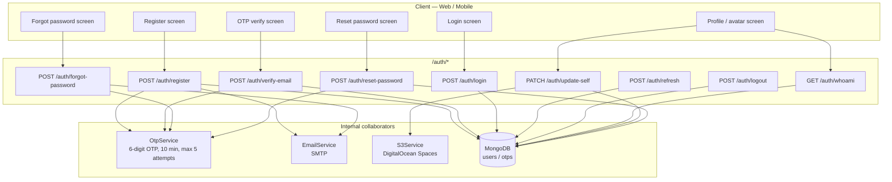
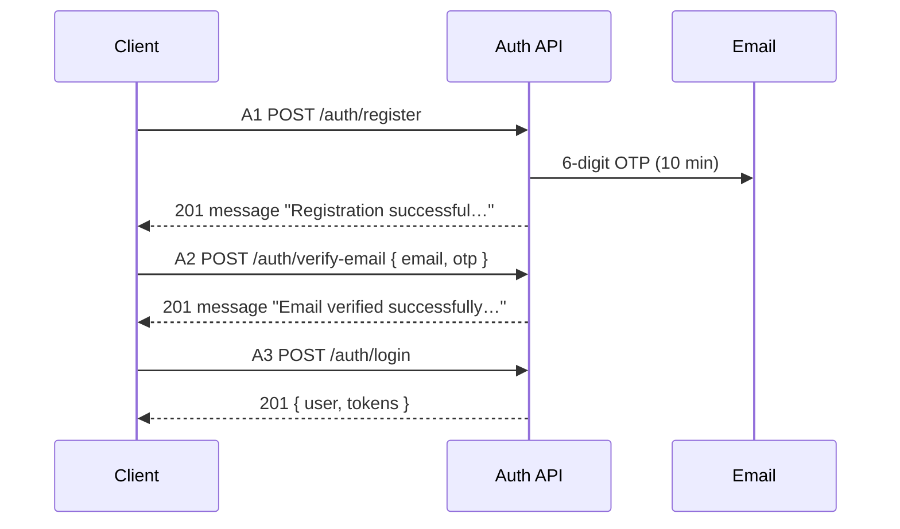
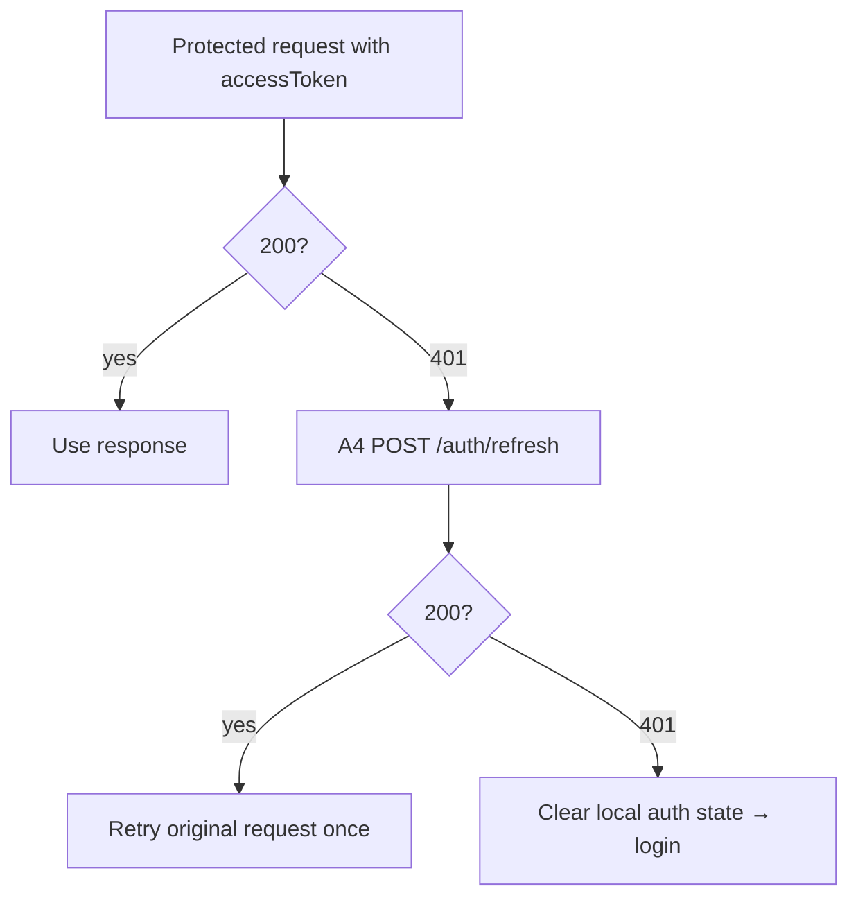
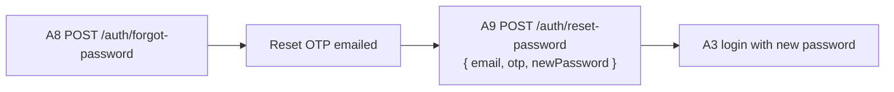
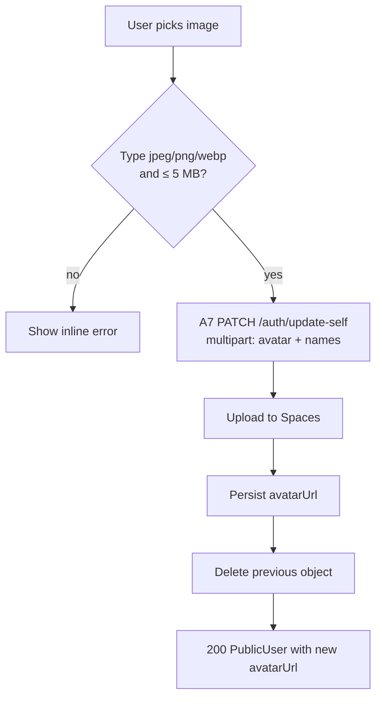

# Communication Coach — Auth API Documentation

Complete reference for every endpoint exposed by `AuthController`
([src/modules/auth/controllers/auth.controller.ts](../src/modules/auth/controllers/auth.controller.ts)).

---

## Architecture



**Base URL:** `{BASE_URL}` — e.g. `http://localhost:5000`

- Swagger UI: `{BASE_URL}/api/docs`
- OpenAPI JSON: `{BASE_URL}/api/docs-json`
- There is **no global route prefix**, so paths are exactly `/auth/...`.
- The Swagger server entry uses `PORT || 5000` while `main.ts` listens on `PORT || 3000`. Set `PORT` explicitly to avoid the mismatch.

**Standard request headers:**

```typescript
{
  "Content-Type": "application/json",       // omit for multipart (update-self with avatar)
  "Authorization": "Bearer <accessToken>",  // protected endpoints only
}
```

**HTTP status code convention:** no `@HttpCode()` decorator overrides the defaults anywhere in this controller, so success responses follow Nest's defaults — **every `POST` returns `201`**, while `GET` and `PATCH` return `200`. Treat any 2xx as success rather than checking for a specific code.

---

## Shared TypeScript Types

```typescript
/** MongoDB ObjectId as a 24-char hex string */
export type ObjectId = string;

export type Role = "user" | "admin";
export type UserStatus = "active" | "inactive" | "suspended" | "pending";

/** User document as returned by the API — sensitive fields are stripped */
export interface PublicUser {
  _id: ObjectId;
  id: ObjectId;          // virtual alias of _id
  firstName: string;
  lastName: string;
  fullName: string;      // virtual: `${firstName} ${lastName}`
  email: string;
  avatarUrl?: string;
  role: Role;
  status: UserStatus;
  emailVerified: boolean;
  isBlocked: boolean;
  createdAt: string;     // ISO date
  updatedAt: string;     // ISO date
  // password, refreshTokenHash and __v are never returned
}

/** Returned by login + refresh — expiresIn is the ACCESS token lifetime in seconds */
export interface TokenPair {
  accessToken: string;
  refreshToken: string;
  expiresIn: number;
}

/** Default shape produced by Nest's exception filter for every error */
export interface ApiError {
  statusCode: number;
  message: string;
  error: string;         // HTTP reason phrase, e.g. "Unauthorized"
}
```

**JWT payload (access + refresh tokens):**

```typescript
export interface JwtPayload {
  sub: ObjectId;         // user id
  email: string;
  iat: number;
  exp: number;
}
```

| Token | Secret | Default lifetime | Config env |
|-------|--------|------------------|------------|
| Access | `JWT_SECRET` | `15m` | `JWT_EXPIRES_IN` |
| Refresh | `JWT_REFRESH_SECRET` | `7d` | `JWT_REFRESH_EXPIRES_IN` |

---

## Endpoint Overview

| ID | Method | Path | Auth | Purpose |
|----|--------|------|------|---------|
| A1 | POST | `/auth/register` | None | Create pending account, email an OTP |
| A2 | POST | `/auth/verify-email` | None | Verify email with OTP → activate account |
| A3 | POST | `/auth/login` | None | Login → access + refresh tokens |
| A4 | POST | `/auth/refresh` | None (refresh token in body) | Exchange refresh token for a new pair |
| A5 | POST | `/auth/logout` | Bearer | Clear stored refresh token hash |
| A6 | GET | `/auth/whoami` | Bearer | Current user profile |
| A7 | PATCH | `/auth/update-self` | Bearer | Update own name and/or avatar |
| A8 | POST | `/auth/forgot-password` | None | Email a password-reset OTP |
| A9 | POST | `/auth/reset-password` | None | Reset password using that OTP |

**Account lifecycle:** `register` → `status: "pending"`, `emailVerified: false` → `verify-email` → `status: "active"`, `emailVerified: true` → `login` allowed. **Login is rejected until the email is verified.**

**OTP rules (all OTP endpoints):**

| Rule | Value |
|------|-------|
| Format | Exactly 6 digits, generated from `crypto.randomBytes` |
| Lifetime | 10 minutes |
| Max attempts | 5 per OTP (6th failure requires a new OTP) |
| Concurrency | One active OTP per `email + type`; requesting a new one invalidates the previous |
| Storage | MongoDB `otps` collection, TTL index auto-deletes expired rows |

---

## A. Endpoint Details

### A1 — Register

| | |
|---|---|
| **Method / Path** | `POST /auth/register` |
| **Auth** | None |
| **Body** | `application/json` |
| **Source** | [auth.controller.ts:39](../src/modules/auth/controllers/auth.controller.ts#L39) |

**Request body (all fields required):**

```typescript
interface RegisterRequest {
  firstName: string;   // 1–50 chars
  lastName: string;    // 1–50 chars
  email: string;       // valid email; stored lowercase + trimmed
  password: string;    // min 6 chars; hashed with scrypt before storage
}
```

**Success `201`:**

```typescript
interface RegisterResponse {
  message: string;     // see the two variants below
}
```

| Case | `message` |
|------|-----------|
| New email | `"Registration successful. Please check your email for the OTP to verify your account."` |
| Email exists but is **not verified** | `"An OTP has been sent to your email for verification. Please verify to activate your account."` |

**Errors:**

| Status | `message` | When |
|--------|-----------|------|
| 400 | `"An account with this email already exists"` | Email exists and is already verified |

**Example:**

```json
// POST /auth/register
{
  "firstName": "John",
  "lastName": "Doe",
  "email": "johndoe@example.com",
  "password": "SecurePass123"
}
```

**Notes:**

- Registering an unverified email is **idempotent-by-resend**: no duplicate user is created, a fresh OTP is issued and the previous one is invalidated.
- No tokens are returned. The client must complete A2 and then call A3.
- The new user is created with `role: "user"`, `status: "pending"`, `emailVerified: false`, `isBlocked: false`.
- Email delivery failure does **not** fail the request — the OTP is already persisted, so the client can retry via A1 (same address) to get a new code.

---

### A2 — Verify Email

| | |
|---|---|
| **Method / Path** | `POST /auth/verify-email` |
| **Auth** | None |
| **Body** | `application/json` |
| **Source** | [auth.controller.ts:52](../src/modules/auth/controllers/auth.controller.ts#L52) |

**Request body:**

```typescript
interface VerifyEmailRequest {
  email: string;  // must match the address the OTP was issued to
  otp: string;    // exactly 6 digits
}
```

**Success `201`:**

```typescript
interface VerifyEmailResponse {
  message: string; // "Email verified successfully. You can now log in."
}
```

**Errors:**

| Status | `message` | When |
|--------|-----------|------|
| 400 | `"OTP is invalid or expired"` | No live OTP exists for this email + `email_verification` |
| 400 | `"Invalid OTP"` | Code mismatch (increments the attempt counter) |
| 400 | `"Too many OTP attempts. Please request a new OTP"` | Attempt counter already at 5 |
| 400 | `"User not found"` | OTP valid but no user document for that email |

**Side effects:** sets `emailVerified = true` and `status = "active"`, then deletes the OTP record (single use).

**Example:**

```json
// POST /auth/verify-email
{ "email": "johndoe@example.com", "otp": "423871" }
```

---

### A3 — Login

| | |
|---|---|
| **Method / Path** | `POST /auth/login` |
| **Auth** | None |
| **Body** | `application/json` |
| **Source** | [auth.controller.ts:65](../src/modules/auth/controllers/auth.controller.ts#L65) |

**Request body:**

```typescript
interface LoginRequest {
  email: string;
  password: string;
}
```

**Success `201`:**

```typescript
interface LoginResponse {
  user: PublicUser;
  tokens: TokenPair;
}
```

**Errors** — all `401`, and all three cases are distinguishable only by `message`:

| Status | `message` | When |
|--------|-----------|------|
| 401 | `"Invalid email or password"` | Unknown email **or** wrong password (deliberately indistinguishable) |
| 401 | `"Email not verified. Please check your inbox for the OTP."` | Credentials valid but A2 not completed |
| 401 | `"Your account has been blocked. Please contact support."` | `isBlocked === true` |

**Example response:**

```json
{
  "user": {
    "_id": "674a1b2c3d4e5f6789012345",
    "id": "674a1b2c3d4e5f6789012345",
    "firstName": "John",
    "lastName": "Doe",
    "fullName": "John Doe",
    "email": "johndoe@example.com",
    "role": "user",
    "status": "active",
    "emailVerified": true,
    "isBlocked": false,
    "createdAt": "2026-03-01T10:00:00.000Z",
    "updatedAt": "2026-03-01T10:05:00.000Z"
  },
  "tokens": {
    "accessToken": "eyJhbGciOiJIUzI1NiIs...",
    "refreshToken": "eyJhbGciOiJIUzI1NiIs...",
    "expiresIn": 900
  }
}
```

**Client storage:** tokens are returned in the body — this API sets **no cookies**. The client decides where to keep them. `expiresIn` is the access-token lifetime in seconds (900 for the `15m` default).

---

### A4 — Refresh Token

| | |
|---|---|
| **Method / Path** | `POST /auth/refresh` |
| **Auth** | None — the refresh token travels in the body |
| **Body** | `application/json` |
| **Source** | [auth.controller.ts:78](../src/modules/auth/controllers/auth.controller.ts#L78) |

**Request body:**

```typescript
interface RefreshRequest {
  refreshToken: string;
}
```

**Success `201`:** the token pair **only** — no `user` object.

```typescript
type RefreshResponse = TokenPair;
```

**Errors:**

| Status | `message` | When |
|--------|-----------|------|
| 401 | `"Invalid or expired refresh token"` | Bad signature, expired, unknown user, unverified user, or blocked user |

All failure modes return that single message: the service throws a more specific error internally but catches and rewrites it, so the client cannot distinguish causes.

**Client flow:** on a `401` from any protected endpoint, call A4 once and retry the original request. If A4 itself returns `401`, clear local auth state and route to login.

---

### A5 — Logout

| | |
|---|---|
| **Method / Path** | `POST /auth/logout` |
| **Auth** | `Authorization: Bearer <accessToken>` |
| **Body** | none |
| **Source** | [auth.controller.ts:91](../src/modules/auth/controllers/auth.controller.ts#L91) |

**Success `201`:**

```typescript
interface LogoutResponse {
  message: string; // "Logged out successfully"
}
```

**Errors:**

| Status | `message` | When |
|--------|-----------|------|
| 401 | `"Authentication require handle request"` | Bearer token missing or invalid |
| 401 | `"User not found or inactive"` | Token valid but no matching verified user |
| 401 | `"User is blocked"` | `isBlocked === true` |

**Side effect:** unsets `refreshTokenHash` on the user document.

> **Important:** the refresh token is a stateless JWT and is **not** validated against `refreshTokenHash`, so a previously issued refresh token **keeps working until it expires** (`7d` by default). Logout clears client state but does not revoke the refresh token server-side. Treat logout as a client-side action and keep access-token lifetimes short.

---

### A6 — Whoami

| | |
|---|---|
| **Method / Path** | `GET /auth/whoami` |
| **Auth** | `Authorization: Bearer <accessToken>` |
| **Source** | [auth.controller.ts:106](../src/modules/auth/controllers/auth.controller.ts#L106) |

**Success `200`:** `PublicUser` (same shape as `loginResponse.user`).

```typescript
type WhoamiResponse = PublicUser;
```

**Errors:**

| Status | `message` | When |
|--------|-----------|------|
| 401 | `"Authentication require handle request"` | Missing/invalid bearer token |
| 401 | `"User not found or inactive"` | Token valid but no matching verified user |
| 400 | `"User not found"` | Token valid but the user document no longer exists |

**UI:** call on app boot to restore a session. `401` → redirect to login. This is the canonical place to read `avatarUrl`.

---

### A7 — Update Self

| | |
|---|---|
| **Method / Path** | `PATCH /auth/update-self` |
| **Auth** | `Authorization: Bearer <accessToken>` |
| **Body** | `multipart/form-data` (or `application/json` when no avatar) |
| **Source** | [auth.controller.ts:121](../src/modules/auth/controllers/auth.controller.ts#L121) |

Updates the caller's own profile. Every field is optional, but **at least one** must be present.

**Request:**

```typescript
interface UpdateSelfRequest {
  firstName?: string;     // 1–50 chars
  lastName?: string;      // 1–50 chars
  avatar?: File;          // multipart field name is exactly "avatar"
}
```

**Avatar constraints:**

| Constraint | Value | Enforced as |
|------------|-------|-------------|
| Allowed types | `image/jpeg`, `image/png`, `image/webp` | `400` |
| Max size | 5 MB | `413` (Multer limit) then `400` (service check) |
| Count | 1 file, field name `avatar` | `400` |
| Empty file | rejected | `400 "Avatar file is empty"` |

**Success `200`:** the updated `PublicUser`.

**Errors:**

| Status | `message` | When |
|--------|-----------|------|
| 400 | `"No fields to update"` | Neither a name nor a file was sent |
| 400 | `"User not found"` | Token valid but user document is gone |
| 400 | `"Avatar file is empty"` | Zero-byte upload |
| 400 | `"Avatar must be one of: image/jpeg, image/png, image/webp"` | Unsupported MIME type |
| 400 | `"Avatar must not exceed 5 MB"` | Service-side size check |
| 401 | `"Authentication require handle request"` | Missing/invalid bearer token |
| 401 | `"User not found or inactive"` | Token valid but no matching verified user |
| 413 | — | File exceeded the Multer `fileSize` limit |

**Avatar replacement semantics:**

1. The new image is validated, then uploaded to Spaces under
   `volkai-college/users/{userId}/{YYYY-MM-DD}/{random}_{name}.{ext}` with `public-read`.
2. Only after the new URL is persisted is the previous object deleted.
3. If the database write fails, the just-uploaded object is deleted instead — nothing is orphaned.
4. If the stored `avatarUrl` does not point at this bucket/CDN (e.g. an externally hosted image), the object is left untouched and a warning is logged.
5. Cleanup failures are logged but do **not** fail the request.

**Examples:**

```bash
# Name only (JSON)
curl -X PATCH "$BASE_URL/auth/update-self" \
  -H "Authorization: Bearer $ACCESS_TOKEN" \
  -H "Content-Type: application/json" \
  -d '{"firstName":"John","lastName":"Doe"}'

# Name + avatar (multipart — do NOT set Content-Type manually)
curl -X PATCH "$BASE_URL/auth/update-self" \
  -H "Authorization: Bearer $ACCESS_TOKEN" \
  -F "firstName=John" \
  -F "avatar=@me.png"
```

**UI:** on success, replace the cached user in the auth store with the response body so `avatarUrl` stays in sync.

---

### A8 — Forgot Password

| | |
|---|---|
| **Method / Path** | `POST /auth/forgot-password` |
| **Auth** | None |
| **Body** | `application/json` |
| **Source** | [auth.controller.ts:148](../src/modules/auth/controllers/auth.controller.ts#L148) |

**Request body:**

```typescript
interface ForgotPasswordRequest {
  email: string;
}
```

**Success `201` — identical for known and unknown emails (anti-enumeration):**

```typescript
interface ForgotPasswordResponse {
  message: string; // "If an account with this email exists, an OTP has been sent to reset your password."
}
```

**Side effect:** for a registered email, a `password_reset` OTP is generated and emailed. For an unknown email, no OTP is created and the same response is returned.

**UI:** always show the generic confirmation, then route the user to the reset screen (A9).

---

### A9 — Reset Password

| | |
|---|---|
| **Method / Path** | `POST /auth/reset-password` |
| **Auth** | None |
| **Body** | `application/json` |
| **Source** | [auth.controller.ts:161](../src/modules/auth/controllers/auth.controller.ts#L161) |

**Request body:**

```typescript
interface ResetPasswordRequest {
  email: string;
  otp: string;         // exactly 6 digits, from the reset email
  newPassword: string; // min 6 chars
}
```

**Success `201`:**

```typescript
interface ResetPasswordResponse {
  message: string; // "Password has been reset successfully. You can now log in with your new password."
}
```

**Errors:** identical to A2's OTP errors (`"OTP is invalid or expired"`, `"Invalid OTP"`, `"Too many OTP attempts. Please request a new OTP"`), but against the `password_reset` OTP type. A5's OTP cannot be used here and vice versa.

**Notes:**

- The OTP is single-use; the record is deleted on success.
- Existing access tokens stay valid until they expire, and refresh tokens are **not** revoked — a password reset does not sign other sessions out.
- The password is re-hashed with scrypt (32-byte random salt, N=16384/r=8/p=1).

**Example:**

```json
// POST /auth/reset-password
{
  "email": "johndoe@example.com",
  "otp": "423871",
  "newPassword": "NewSecurePass456"
}
```

---

## Auth Flows

### Registration and first login



### Session refresh



### Password reset



### Avatar update



---

## Response Field Reference

### `PublicUser`

Returned by A3 (`user`), A6, and A7.

| Field | Type | Meaning | UI usage | Example |
|-------|------|---------|----------|---------|
| `_id` | `ObjectId` | User id | Store in auth context | `"674a1b2c3d4e5f6789012345"` |
| `id` | `ObjectId` | Virtual alias of `_id` | Interchangeable with `_id` | same |
| `firstName` | `string` | Given name | Profile form default, greeting | `"John"` |
| `lastName` | `string` | Family name | Profile form default | `"Doe"` |
| `fullName` | `string` | Virtual `"{firstName} {lastName}"` | Navbar/menu label | `"John Doe"` |
| `email` | `string` | Login address (lowercase) | Read-only on profile | `"johndoe@example.com"` |
| `avatarUrl` | `string?` | Public Spaces URL | `<Avatar src={avatarUrl} />`; fall back to initials | `"https://bucket.…/me.png"` |
| `role` | `Role` | `"user"` \| `"admin"` | Gate admin-only screens | `"user"` |
| `status` | `UserStatus` | Account state | `pending` → prompt email verification | `"active"` |
| `emailVerified` | `boolean` | Verification flag | Show "verify your email" banner when `false` | `true` |
| `isBlocked` | `boolean` | Blocked by admin | Deny access, show support message | `false` |
| `createdAt` | `ISO string` | Registration date | "Member since …" | `"2026-03-01T10:00:00.000Z"` |
| `updatedAt` | `ISO string` | Last profile change | Debug / cache busting | ISO |

Never present in responses: `password`, `refreshTokenHash`, `__v`.

### `TokenPair`

| Field | Type | Meaning | UI usage | Example |
|-------|------|---------|----------|---------|
| `accessToken` | `string` | Short-lived JWT | Send as `Authorization: Bearer …` | `"eyJhbGciOi…"` |
| `refreshToken` | `string` | Long-lived JWT | Store securely; send only to A4 | `"eyJhbGciOi…"` |
| `expiresIn` | `number` | Access-token lifetime in **seconds** | Schedule proactive refresh before expiry | `900` |

---

## Error Reference

All errors come from Nest's default exception filter:

```typescript
{ statusCode: number; message: string; error: string }
```

| HTTP | Typical `message` | Endpoints | Client handling |
|------|-------------------|-----------|-----------------|
| 400 | `"An account with this email already exists"` | A1 | Inline on the email field, link to login |
| 400 | `"OTP is invalid or expired"` | A2, A9 | Inline on OTP field, offer "resend" |
| 400 | `"Invalid OTP"` | A2, A9 | Inline; show remaining attempts if tracked |
| 400 | `"Too many OTP attempts. Please request a new OTP"` | A2, A9 | Disable OTP input, force resend (A1/A8) |
| 400 | `"No fields to update"` | A7 | Should be prevented client-side |
| 400 | `"Avatar must be one of: …"` / `"Avatar must not exceed 5 MB"` / `"Avatar file is empty"` | A7 | Inline under the avatar picker |
| 401 | `"Invalid email or password"` | A3 | Generic inline error — do not reveal which field failed |
| 401 | `"Email not verified. Please check your inbox for the OTP."` | A3 | Redirect to the OTP screen and resend via A1 |
| 401 | `"Your account has been blocked. Please contact support."` | A3 | Blocking screen with support contact |
| 401 | `"Invalid or expired refresh token"` | A4 | Clear auth state → login |
| 401 | `"Authentication require handle request"` | A5, A6, A7 | Clear auth state → login |
| 401 | `"User not found or inactive"` | A5, A6, A7 | Clear auth state → login |
| 401 | `"User is blocked"` | A5, A6, A7 | Blocking screen with support contact |
| 413 | — | A7 | "Image is too large (max 5 MB)" |

---

## Implementation Notes

Facts worth knowing when integrating — all verified against the source:

1. **No runtime request validation.** A global `ValidationPipe` is **not** registered (`main.ts` has no `useGlobalPipes`, and no `APP_PIPE`/`APP_GUARD` provider exists). The `class-validator` decorators on the DTOs — email format, `@MinLength`, `@MaxLength`, the 6-digit OTP `@Length` — document intent and drive Swagger, but malformed bodies are **not** rejected with a 400 by validation. Services enforce what they actually need (OTP matching, avatar type/size, "no fields to update"). Validate on the client, and treat the Swagger schema as advisory.

2. **DTO validation errors never appear as arrays.** Because of the above, `message` is always a plain string.

3. **Refresh tokens are not revocable.** `refreshTokenHash` exists on the schema and A5 unsets it, but nothing ever writes it, and A4 does not compare against it. A refresh token stays valid until its `exp` regardless of logout or password reset.

4. **Rate limiting is configured but inert.** `ThrottlerModule` is registered in `app.module.ts`, but no `ThrottlerGuard` is applied globally or per-route, so no endpoint is throttled today. Do not rely on it for OTP brute-force protection server-side; the per-OTP 5-attempt cap is the only such limit.

5. **No cookies.** Every token is returned in the response body, so CSRF is not a concern here, but the client must handle token storage and XSS exposure itself.

6. **Email failures are swallowed.** `sendOtpEmail` catches and logs; registration still succeeds. If a user reports "no OTP", have them re-trigger A1 (unverified) or A8 (reset).

7. **`register` on an unverified email is a resend**, not an error — the client can use it as a "resend OTP" button before verification.

8. **Protected routes reject blocked users at the guard.** `JwtAuthGuard` returns `401 "User is blocked"` before the handler runs, so A5/A6/A7 never execute for a blocked account.

9. **Login errors are not rate limited or delay-padded** beyond the scrypt work factor. If you need brute-force protection, it belongs at the gateway.

---

**Total endpoints:** 9 (A1–A9), all under `/auth`.
