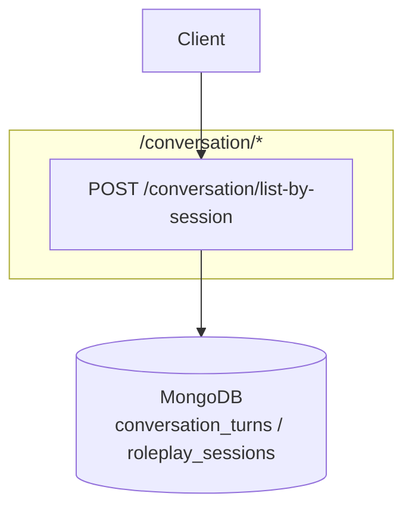

# Communication Coach — Conversation API Documentation

Complete reference for endpoints exposed by `ConversationController`
([src/modules/recording/controllers/conversation.controller.ts](../src/modules/recording/controllers/conversation.controller.ts)).

---

## Architecture



**Base URL:** `{BASE_URL}` — e.g. `http://localhost:5000`

- Swagger UI: `{BASE_URL}/api/docs`
- OpenAPI JSON: `{BASE_URL}/api/docs-json`
- There is no global route prefix — paths are exactly `/conversation/...`.
- Default status codes: no `@HttpCode()` override; Nest defaults apply — `POST` returns `201`, `GET` returns `200`.

**Standard request headers:**

```typescript
{
  "Content-Type": "application/json",
  "Authorization": "Bearer <ACCESS_TOKEN>"  // protected endpoints
}
```

---

## Shared TypeScript Types

```typescript
/** MongoDB ObjectId as a 24-char hex string */
export type ObjectId = string;

export type ConversationSpeaker = "user" | "ai";

/** Single turn of a conversation */
export interface ConversationTurnDto {
  _id: ObjectId;
  sessionId: ObjectId;
  speaker: ConversationSpeaker;
  sequence: number;       // 1..N ordering within the session
  text: string;
  startTimeSec?: number;
  endTimeMsSec?: number;
  durationSec?: number;
  wordCount?: number;
  createdAt: string;      // ISO date
  updatedAt: string;      // ISO date
}
```

---

## Endpoint Overview

| ID | Method | Path | Auth | Purpose |
|----|--------|------|------|---------|
| C1 | POST | `/conversation/list-by-session` | Bearer JWT | List all conversation turns for a session |

---

## C1 — List conversation turns by session

| | |
|---|---|
| **Method / Path** | `POST /conversation/list-by-session` |
| **Auth** | Bearer JWT |
| **Body** | `application/json` |
| **Source** | [conversation.controller.ts](../src/modules/recording/controllers/conversation.controller.ts) |
| **DTO** | [get-conversation-by-session.dto.ts](../src/modules/recording/dto/get-conversation-by-session.dto.ts) |

**Request body:**

```typescript
interface GetConversationBySessionRequest {
  sessionId: string; // Mongo ObjectId
}
```

**Success 201:** returns all turns for the session, ordered by `sequence` (then `createdAt`).

```typescript
// Response: ConversationTurnDto[]
[
  {
    "_id": "...",
    "sessionId": "...",
    "speaker": "ai",
    "sequence": 1,
    "text": "Welcome to the roleplay...",
    "createdAt": "2026-10-13T11:00:00.000Z",
    "updatedAt": "2026-10-13T11:00:00.000Z"
  }
]
```

**Errors:**

| Status | `message` | When |
|--------|-----------|------|
| 400 | `"Invalid session id"` | `sessionId` is not a valid ObjectId |
| 400 | `"Session not found"` | No session with that id exists |
| 400 | `"This session does not belong to the authenticated user"` | Auth user mismatch |
| 401 | `"Unauthorized"` | Missing/invalid token |

**Example cURL:**

```bash
curl -X POST "{BASE_URL}/conversation/list-by-session" \
  -H "Authorization: Bearer $ACCESS_TOKEN" \
  -H "Content-Type: application/json" \
  -d '{
    "sessionId": "66d1d5f1d8d3070019e8f8c9"
  }'
```

**Notes:**
- Results are sorted to reflect the actual dialog order within the session.
- Only the session owner can read its conversation turns (ownership is enforced).
