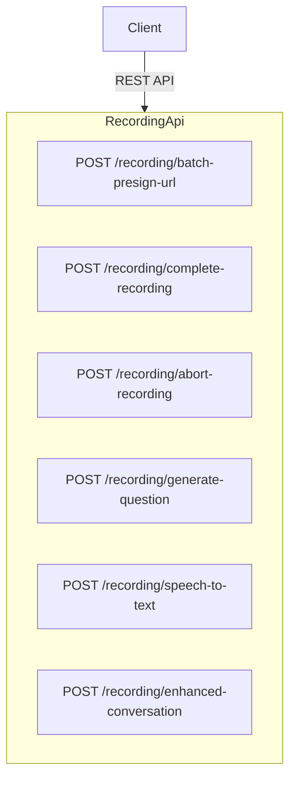

# Communication Coach — Recording API Documentation

Complete reference for every endpoint exposed by `RecordingController` ([src/modules/recording/controllers/recording.controller.ts](../src/modules/recording/controllers/recording.controller.ts)).

---

## Architecture



**Swagger UI URL:** `{BASE_URL}/api/docs`

**Headers:** All endpoints require the bearer authorization token. Use the content type required by the endpoint (JSON for conversation enhancement; multipart/form-data for audio uploads).

```json
{
  "Authorization": "Bearer <user-access-token>",
  "Content-Type": "application/json"
}
```

### Overview:

| Path                               | Method | Purpose                                                                      |
| ---------------------------------- | ------ | ---------------------------------------------------------------------------- |
| `/recording/batch-presign-url`     | POST   | Generate presigned S3 upload links for audio recording.                      |
| `/recording/complete-recording`    | POST   | Complete multipart uploads and retrieve MP3 link.                            |
| `/recording/speech-to-text`        | POST   | Upload recording chunks for AI speech parsing                                |
| `/recording/enhanced-conversation` | POST   | Rewrite a user answer naturally and provide optional vocabulary suggestions. |

## Enhance a conversation turn

`POST /recording/enhanced-conversation` accepts a JSON body containing the ID
of a conversation turn. The authenticated user must own the session, and the
turn must be a user answer with a preceding AI turn. The AI question and answer
are provided to the language agent as context. The resulting natural sentence
and vocabulary suggestions are saved in that user's turn's `enhancedTurn`
field.

**Request:**

```json
{
  "conversationTurnId": "6accc2074f59dd54ee0591ef"
}
```

**Example request:**

```bash
curl -X POST "{BASE_URL}/recording/enhanced-conversation" \
  -H "Authorization: Bearer <ACCESS_TOKEN>" \
  -H "Content-Type: application/json" \
  -d '{"conversationTurnId":"6accc2074f59dd54ee0591ef"}'
```

**Success 201 Created:**

```json
{
  "conversationTurnId": "6accc2074f59dd54ee0591ef",
  "previousAiQuestion": "What specific problem does your project solve?",
  "originalSentence": "It solves AI automation problem and help business.",
  "enhancedTurn": {
    "naturalSentence": "It addresses challenges in AI automation and helps businesses work more efficiently.",
    "vocabularyItems": [
      {
        "word": "address",
        "meaning": "to deal with or work on a problem",
        "exampleWordInSentence": "The project addresses challenges in AI automation."
      }
    ]
  }
}
```

`vocabularyItems` may be empty when no additional vocabulary would be useful.
Each item gives a simple meaning and an example in the context of the enhanced
answer. The endpoint returns `400 Bad Request` for an invalid or missing turn,
a non-user turn, a turn without a preceding AI question, or a session the
caller does not own. An unauthenticated or invalidly authenticated request
returns `401 Unauthorized`.
