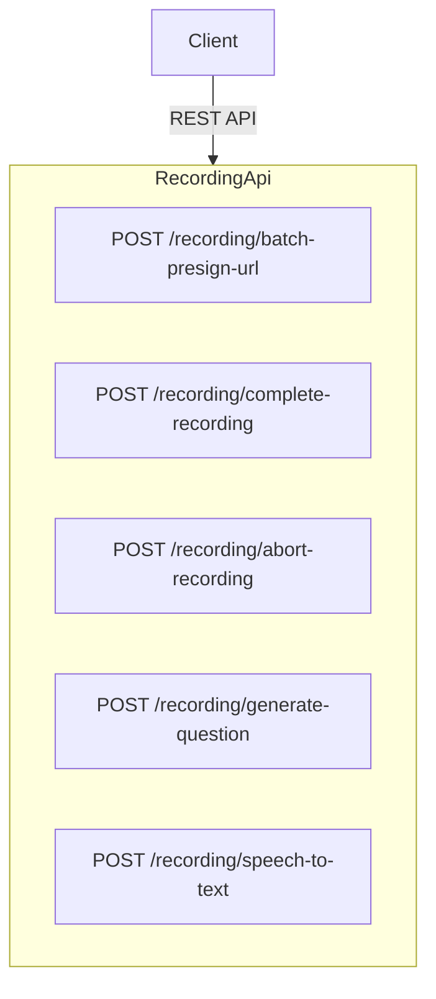

# Communication Coach — Recording API Documentation

Complete reference for every endpoint exposed by `RecordingController` ([src/modules/recording/controllers/recording.controller.ts](../src/modules/recording/controllers/recording.controller.ts)).

---

## Architecture



**Swagger UI URL:** `{BASE_URL}/api/docs`

**Standard Headers:**

```json
{
  "Authorization": "Bearer <user-access-token>",
  "Content-Type": "multipart/form-data"
}
```

### Overview:

| Path                         | Method  | Purpose                                                  |
|------------------------------|---------|----------------------------------------------------------|
| `/recording/batch-presign-url` | POST    | Generate presigned S3 upload links for audio recording.  |
| `/recording/complete-recording` | POST    | Complete multipart uploads and retrieve MP3 link.        |
| `/recording/speech-to-text`   | POST    | Upload recording chunks for AI speech parsing            |