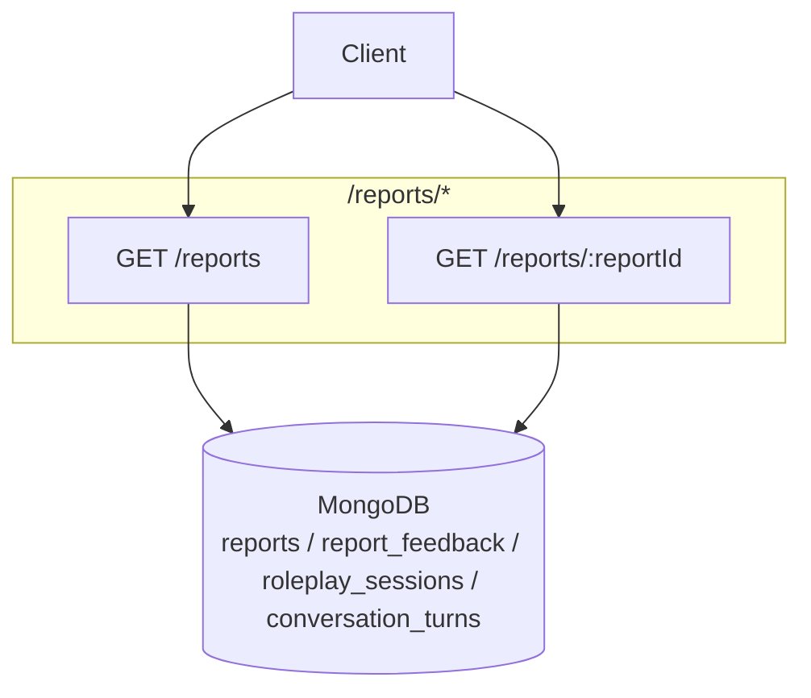

# Communication Coach — Reports API Documentation

Complete reference for endpoints exposed by `ReportController`
([src/modules/report/controllers/report.controller.ts](../src/modules/report/controllers/report.controller.ts)).

---

## Architecture



**Base URL:** `{BASE_URL}` — e.g. `http://localhost:5000`

- Swagger UI: `{BASE_URL}/api/docs`
- OpenAPI JSON: `{BASE_URL}/api/docs-json`
- There is no global route prefix — paths are exactly `/reports/...`.
- HTTP status codes: no controller-level overrides — all endpoints here are `GET` and return `200` on success.

**Standard request headers:**

```typescript
{
  "Content-Type": "application/json",
  "Authorization": "Bearer <ACCESS_TOKEN>"  // protected endpoints
}
```

---

## Shared TypeScript Types

```typescript
/** MongoDB ObjectId as a 24-char hex string */
export type ObjectId = string;

export type ReportStatus = "generating" | "completed" | "failed";

export interface ReportDto {
  _id: ObjectId;
  sessionId: ObjectId;
  userId: ObjectId;
  status: ReportStatus;
  overallScore?: number;  // 0..5
  summary?: string;
  recordingUrl?: string;  // final public MP3 URL when available
  model?: string;
  promptVersion?: string;
  createdAt: string;      // ISO date
  updatedAt: string;      // ISO date
}

export type ConversationSpeaker = "user" | "ai";

export interface ConversationTurnDto {
  _id: ObjectId;
  sessionId: ObjectId;
  speaker: ConversationSpeaker;
  sequence: number;
  text: string;
  startTimeSec?: number;
  endTimeMsSec?: number;
  durationSec?: number;
  wordCount?: number;
  createdAt: string;
  updatedAt: string;
}

export interface ReportFeedbackDto {
  reportId: ObjectId;
  activeListening: { score: number; feedback: string; };
  star: {
    situation: { score: number; feedback: string; };
    task: { score: number; feedback: string; };
    action: { score: number; feedback: string; };
    result: { score: number; feedback: string; };
    overallScore?: number;
  };
  strengths: string[];
  growthPoints: string[];
  tones: string[];
  conciseness: { score: number; feedback: string; };
  createdAt: string;
  updatedAt: string;
}
```

---

## Endpoint Overview

| ID | Method | Path | Auth | Purpose |
|----|--------|------|------|---------|
| R1 | GET | `/reports` | Bearer JWT | Paginated, filterable list of the current user’s reports |
| R2 | GET | `/reports/:reportId` | Bearer JWT | Full report detail + feedback + conversation turns |

---

## R1 — List reports (current user)

| | |
|---|---|
| **Method / Path** | `GET /reports` |
| **Auth** | Bearer JWT |
| **Query** | `?page=1&limit=20&search=...&sessionId=...&status=completed&minScore=0&maxScore=5&createdFrom=...&createdTo=...&sortBy=createdAt&order=desc` |
| **Source** | [report.controller.ts](../src/modules/report/controllers/report.controller.ts) |
| **DTO** | [list-reports.dto.ts](../src/modules/recording/dto/list-reports.dto.ts) |

**Query parameters (all optional):**

```typescript
interface ListReportsRequest {
  sessionId?: string;                  // filter to a session
  status?: "generating" | "completed" | "failed";
  search?: string;                     // case-insensitive match in summary
  minScore?: number;                   // 0..5
  maxScore?: number;                   // 0..5
  createdFrom?: string;                // ISO date
  createdTo?: string;                  // ISO date
  page?: number;                       // default 1
  limit?: number;                      // default 20, max 100
  sortBy?: "createdAt" | "overallScore"; // default createdAt
  order?: "asc" | "desc";              // default desc
}
```

**Success 200:**

```typescript
interface ListReportsResponse {
  items: ReportDto[];
  total: number;
  page: number;
  limit: number;
  totalPages: number;
  sortBy: "createdAt" | "overallScore";
  order: "asc" | "desc";
}
Example
{
  "items": [
    {
      "_id": "6ace03ce4597c170172dc6a8",
      "sessionId": "6ace02e8ef4490d0bd1b6eb9",
      "__v": 0,
      "createdAt": "2026-10-13T10:11:26.376Z",
      "model": "gpt-4o-mini",
      "overallScore": 2,
      "promptVersion": "communication-report-agent-v1",
      "status": "completed",
      "summary": "The presentation effectively aimed at addressing the leadership's concerns over project viability but struggled with providing specific, quantifiable metrics and clarity in communication.",
      "updatedAt": "2026-10-13T10:11:26.376Z",
      "userId": "6acc7be60ae96ddb13eb2fc9"
    },
    {
      "_id": "6acdf72b4597c170172dc37e",
      "sessionId": "6acdf68aef4490d0bd1b6eaa",
      "__v": 0,
      "createdAt": "2026-10-13T09:17:31.433Z",
      "model": "gpt-4o-mini",
      "overallScore": 1,
      "promptVersion": "communication-report-agent-v1",
      "status": "completed",
      "summary": "The roleplay shows that the user struggled to provide specific, data-driven achievements to support their request for a salary increase. The user’s vague responses hinder effective negotiation.",
      "updatedAt": "2026-10-13T09:17:31.433Z",
      "userId": "6acc7be60ae96ddb13eb2fc9"
    },
    {
      "_id": "6accd6724597c170172da38d",
      "sessionId": "6accc2254f59dd54ee0591f0",
      "__v": 0,
      "createdAt": "2026-10-12T12:45:37.220Z",
      "model": "gpt-4o-mini",
      "overallScore": 2,
      "promptVersion": "communication-report-agent-v1",
      "status": "completed",
      "summary": "The roleplay lacks adequate detail and specific interaction, as the user response is not provided. The AI's questions indicate a structured approach to assessing achievements. However, without the user's responses, it's challenging to evaluate the full conversation effectively.",
      "updatedAt": "2026-10-12T12:45:37.220Z",
      "userId": "6acc7be60ae96ddb13eb2fc9"
    }
  ],
  "total": 3,
  "page": 1,
  "limit": 20,
  "totalPages": 1,
  "sortBy": "createdAt",
  "order": "desc"
}
```

**Errors:**

| Status | `message` | When |
|--------|-----------|------|
| 401 | `"Unauthorized"` | Missing/invalid token |

**Example cURL:**

```bash
curl -X GET "{BASE_URL}/reports?search=communication&status=completed&minScore=3&page=1&limit=10&sortBy=createdAt&order=desc" \
  -H "Authorization: Bearer $ACCESS_TOKEN" \
```

---

## R2 — Get report detail

| | |
|---|---|
| **Method / Path** | `GET /reports/:reportId` |
| **Auth** | Bearer JWT |
| **Source** | [report.controller.ts](../src/modules/report/controllers/report.controller.ts) |

**Success 200:**

```typescript
interface GetReportDetailResponse {
  report: ReportDto;
  feedback: ReportFeedbackDto | null;  // may be null if not generated yet
  conversation: {
    sessionId: ObjectId;
    session: any;                      // RolePlaySession document
    turns: ConversationTurnDto[];      // ordered by sequence
  };
}

Example: 

{
  "report": {
    "_id": "6ace03ce4597c170172dc6a8",
    "sessionId": "6ace02e8ef4490d0bd1b6eb9",
    "__v": 0,
    "createdAt": "2026-10-13T10:11:26.376Z",
    "model": "gpt-4o-mini",
    "overallScore": 2,
    "promptVersion": "communication-report-agent-v1",
    "status": "completed",
    "summary": "The presentation effectively aimed at addressing the leadership's concerns over project viability but struggled with providing specific, quantifiable metrics and clarity in communication.",
    "updatedAt": "2026-10-13T10:11:26.376Z",
    "userId": "6acc7be60ae96ddb13eb2fc9",
    "recordingUrl": "https://volkai-labs.blr1.digitaloceanspaces.com/roleplay_recordings/user_6acc7be60ae96ddb13eb2fc9/roleplay_6acc7dee0ae96ddb13eb2fcc/session_6ace02e8ef4490d0bd1b6eb9/recording_1791886056844_6ace02e8ef4490d0bd1b6eba.mp3"
  },
  "feedback": {
    "_id": "6ace03ce4597c170172dc6a9",
    "reportId": "6ace03ce4597c170172dc6a8",
    "__v": 0,
    "activeListening": {
      "score": 2,
      "feedback": "The user responded to questions but did not effectively address the specific metrics or provide clear evidence."
    },
    "conciseness": {
      "score": 2,
      "feedback": "Responses were often lengthy and unclear, leading to confusion about the project's value."
    },
    "createdAt": "2026-10-13T10:11:26.399Z",
    "growthPoints": [
      "Lacked specific, quantifiable metrics for the proposed project benefits.",
      "Responses were often vague and could be overly complex for a leadership audience.",
      "Failed to address the financial impact clearly."
    ],
    "star": {
      "situation": {
        "score": 2,
        "feedback": "Situation was described, but specifics about the problem were vague."
      },
      "task": {
        "score": 2,
        "feedback": "Task was implied rather than clearly outlined, lacking specific objectives."
      },
      "action": {
        "score": 2,
        "feedback": "Actions mentioned were not detailed or supported with adequate metrics."
      },
      "result": {
        "score": 2,
        "feedback": "Results were mentioned but lacked clarity and specificity on financial impact."
      },
      "overallScore": 2
    },
    "strengths": [
      "Identified the use of AI technology as a solution.",
      "Mentioned examples of previous projects to support claims."
    ],
    "tones": [
      "Professional",
      "Skeptical",
      "Direct"
    ],
    "updatedAt": "2026-10-13T10:11:26.399Z"
  },
  "conversation": {
    "sessionId": "6ace02e8ef4490d0bd1b6eb9",
    "session": {
      "_id": "6ace02e8ef4490d0bd1b6eb9",
      "userId": "6acc7be60ae96ddb13eb2fc9",
      "rolePlayId": "6acc7dee0ae96ddb13eb2fcc",
      "status": "created",
      "startedAt": "2026-10-13T10:07:36.783Z",
      "createdAt": "2026-10-13T10:07:36.791Z",
      "updatedAt": "2026-10-13T10:07:36.791Z",
      "__v": 0
    },
    "turns": [
      {
        "_id": "6ace02efef4490d0bd1b6ebb",
        "sessionId": "6ace02e8ef4490d0bd1b6eb9",
        "speaker": "ai",
        "sequence": 1,
        "text": "What specific problem does this project aim to address, and how will it benefit our organization?",
        "createdAt": "2026-10-13T10:07:43.421Z",
        "updatedAt": "2026-10-13T10:07:43.421Z",
        "__v": 0
      },
      {
        "_id": "6ace0310ef4490d0bd1b6ebc",
        "sessionId": "6ace02e8ef4490d0bd1b6eb9",
        "speaker": "user",
        "sequence": 2,
        "text": "It solves the AI automation problem and I think AI is the leading technology in the current era and that's why it will help your business.",
        "wordCount": 26,
        "createdAt": "2026-10-13T10:08:16.300Z",
        "updatedAt": "2026-10-13T10:08:16.300Z",
        "__v": 0
      },
      {
        "_id": "6ace0311ef4490d0bd1b6ebd",
        "sessionId": "6ace02e8ef4490d0bd1b6eb9",
        "speaker": "ai",
        "sequence": 3,
        "text": "Can you provide specific metrics or data that demonstrate how this AI automation will improve our operations?",
        "createdAt": "2026-10-13T10:08:17.531Z",
        "updatedAt": "2026-10-13T10:08:17.531Z",
        "__v": 0
      },
      {
        "_id": "6ace0337ef4490d0bd1b6ebe",
        "sessionId": "6ace02e8ef4490d0bd1b6eb9",
        "speaker": "user",
        "sequence": 4,
        "text": "Yes, I can, we can apply automation pipelines with the help of anything in different such tools like Make.com and Cloud Code and ChatGPT, so that the manual tasks could be automated and we don't, we can save somehow time and money eventually.",
        "wordCount": 43,
        "createdAt": "2026-10-13T10:08:55.377Z",
        "updatedAt": "2026-10-13T10:08:55.377Z",
        "__v": 0
      },
      {
        "_id": "6ace0339ef4490d0bd1b6ebf",
        "sessionId": "6ace02e8ef4490d0bd1b6eb9",
        "speaker": "ai",
        "sequence": 5,
        "text": "What specific time and cost savings can you quantify from implementing this automation?",
        "createdAt": "2026-10-13T10:08:57.733Z",
        "updatedAt": "2026-10-13T10:08:57.733Z",
        "__v": 0
      },
      {
        "_id": "6ace0369ef4490d0bd1b6ec0",
        "sessionId": "6ace02e8ef4490d0bd1b6eb9",
        "speaker": "user",
        "sequence": 6,
        "text": "Our process is like, first we understand the business and then we describe such all things because it depends on and it varies based on the business, like how they were implementing and what operations they were doing currently. And as per after analyzing their business process, we will implement, we will design an implementation for their use case to save their time or money.",
        "wordCount": 65,
        "createdAt": "2026-10-13T10:09:45.322Z",
        "updatedAt": "2026-10-13T10:09:45.322Z",
        "__v": 0
      },
      {
        "_id": "6ace036bef4490d0bd1b6ec1",
        "sessionId": "6ace02e8ef4490d0bd1b6eb9",
        "speaker": "ai",
        "sequence": 7,
        "text": "What are some specific examples from similar projects that highlight the return on investment we've seen?",
        "createdAt": "2026-10-13T10:09:47.036Z",
        "updatedAt": "2026-10-13T10:09:47.036Z",
        "__v": 0
      },
      {
        "_id": "6ace038eef4490d0bd1b6ec2",
        "sessionId": "6ace02e8ef4490d0bd1b6eb9",
        "speaker": "user",
        "sequence": 8,
        "text": "like the recent project we had handled is the CA company where they were doing most of the tasks by typing it and we have implemented this, we have reduced the typing with the help of AI, so the mail will typing thing and formatting thing done by AI and thus it saved their time and eventually money.",
        "wordCount": 58,
        "createdAt": "2026-10-13T10:10:22.492Z",
        "updatedAt": "2026-10-13T10:10:22.492Z",
        "__v": 0
      },
      {
        "_id": "6ace0390ef4490d0bd1b6ec3",
        "sessionId": "6ace02e8ef4490d0bd1b6eb9",
        "speaker": "ai",
        "sequence": 9,
        "text": "What were the specific time and cost savings metrics achieved from the CA company's project?",
        "createdAt": "2026-10-13T10:10:24.476Z",
        "updatedAt": "2026-10-13T10:10:24.476Z",
        "__v": 0
      },
      {
        "_id": "6ace03a9ef4490d0bd1b6ec4",
        "sessionId": "6ace02e8ef4490d0bd1b6eb9",
        "speaker": "user",
        "sequence": 10,
        "text": "Like approximately at last we have saved their 40% of time and 20% of the revenue and thus their overall metrics and improvement is like 30% we have estimated.",
        "wordCount": 29,
        "createdAt": "2026-10-13T10:10:49.985Z",
        "updatedAt": "2026-10-13T10:10:49.985Z",
        "__v": 0
      },
      {
        "_id": "6ace03abef4490d0bd1b6ec5",
        "sessionId": "6ace02e8ef4490d0bd1b6eb9",
        "speaker": "ai",
        "sequence": 11,
        "text": "Can you explain how the 40% time savings translate into a financial impact for our organization?",
        "createdAt": "2026-10-13T10:10:51.933Z",
        "updatedAt": "2026-10-13T10:10:51.933Z",
        "__v": 0
      },
      {
        "_id": "6ace03c9ef4490d0bd1b6ec6",
        "sessionId": "6ace02e8ef4490d0bd1b6eb9",
        "speaker": "user",
        "sequence": 12,
        "text": "time saving means that you need four employees if you need six employees and thus it saves manpower spending and thus save the revenue of the business.",
        "wordCount": 27,
        "createdAt": "2026-10-13T10:11:21.371Z",
        "updatedAt": "2026-10-13T10:11:21.371Z",
        "__v": 0
      }
    ]
  }
}
```

**Errors:**

| Status | `message` | When |
|--------|-----------|------|
| 400 | `"Invalid report id"` | `:reportId` is not a valid ObjectId |
| 400 | `"Report not found"` | No report exists with that id |
| 400 | `"This report does not belong to the authenticated user"` | Ownership check failed |
| 401 | `"Unauthorized"` | Missing/invalid token |

**Example cURL:**

```bash
curl -X GET "{BASE_URL}/reports/66d1d5f1d8d3070019e8f8c9" \
  -H "Authorization: Bearer $ACCESS_TOKEN"
```

**Notes:**
- `recordingUrl` is populated after the multipart recording completes.
- Conversation turns are sorted to reflect the dialog order.
