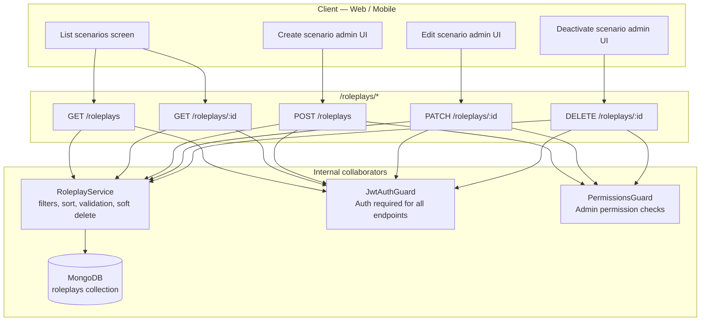

# Communication Coach — RolePlay API Documentation

Complete reference for every endpoint exposed by `RoleplayController`
([src/modules/roleplay/controllers/roleplay.controller.controller.ts](../src/modules/roleplay/controllers/roleplay.controller.controller.ts))
and the `RolePlay` schema it persists to
([src/database/schemas/rolePlay.schema.ts](../src/database/schemas/rolePlay.schema.ts)).

---

## Architecture



**Base URL:** `{BASE_URL}` — e.g. `http://localhost:5000`

- Swagger UI: `{BASE_URL}/api/docs`
- OpenAPI JSON: `{BASE_URL}/api/docs-json`
- Route prefix: there is no global route prefix. The controller mounts at `/roleplays`.
- Every endpoint is protected by JWT auth via `JwtAuthGuard`, so callers must send a valid bearer token.
- Admin-only operations also require a permission via `PermissionsGuard` using:
  - `create:roleplay`
  - `update:roleplay`
  - `delete:roleplay`

**Standard request headers:**

```http
Authorization: Bearer <access_token>
Content-Type: application/json
```

For JSON endpoints, omit `Content-Type` only when the request genuinely has no body.

**HTTP status code convention:**

- `GET` endpoints respond with `200` on success.
- `POST` endpoints respond with `201` on success.
- `PATCH` responds with `200` on success.
- `DELETE` responds with `200` on success.
- Validation and authorization failures use Nest's default error envelope (`statusCode`, `message`, `error`).

---

## Shared TypeScript Types

```typescript
export type ObjectId = string;

export enum RolePlayDifficulty {
  BEGINNER = 'beginner',
  INTERMEDIATE = 'intermediate',
  ADVANCED = 'advanced',
}

export interface RolePlayPersona {
  name: string;
  role: string;
  personality?: string;
}

export interface RolePlay {
  _id: ObjectId;
  id: ObjectId; // virtual alias of _id
  title: string;
  description: string;
  category: string;
  difficulty: RolePlayDifficulty;
  systemPrompt: string;
  aiPersona: RolePlayPersona;
  objectives: string[];
  isActive: boolean;
  createdAt: string;
  updatedAt: string;
}
```

```typescript
export interface PaginatedResult<T> {
  data: T[];
  totalCounts: number;
  currentPage: number;
  totalPages: number;
  limit: number;
  hasNextPage: boolean;
  hasPrevPage: boolean;
  nextPage: number | null;
  prevPage: number | null;
}
```

**JWT payload:**

```typescript
export interface JwtPayload {
  sub: ObjectId;
  email: string;
  iat: number;
  exp: number;
}
```

The roleplay module does not mint its own token; it depends on the same auth system used by the rest of the API.

---

## Endpoint Overview

| ID | Method | Path | Auth | Permission | Purpose |
|----|--------|------|------|------------|---------|
| R1 | GET | `/roleplays` | Required | None | List roleplay scenarios with pagination and filters |
| R2 | GET | `/roleplays/:id` | Required | None | Fetch one scenario by id |
| R3 | POST | `/roleplays` | Required | `create:roleplay` | Create a scenario |
| R4 | PATCH | `/roleplays/:id` | Required | `update:roleplay` | Partial update of a scenario |
| R5 | DELETE | `/roleplays/:id` | Required | `delete:roleplay` | Soft-deactivate a scenario |

**Scenario lifecycle:**

- A scenario is created with `isActive: true` by default.
- `GET /roleplays` and `GET /roleplays/:id` return active and inactive scenarios unless the caller filters by `isActive`.
- `DELETE /roleplays/:id` is a soft delete: it sets `isActive = false` rather than removing the document.
- `PATCH /roleplays/:id` can reactivate a scenario by sending `isActive: true`.

---

## Query / Filtering Rules

### List response

`GET /roleplays` returns a paginated result. The service clamps paging to safe bounds:

- `page`: minimum `1`, defaults to `1`
- `limit`: minimum `1`, maximum `100`, defaults to `10`

### Allowed query parameters

```typescript
interface QueryRolePlayDto {
  page?: number;          // default 1
  limit?: number;         // default 10, max 100
  search?: string;        // case-insensitive match on title and description
  category?: string;      // exact match
  difficulty?: RolePlayDifficulty;
  isActive?: boolean;     // omit to include both active and inactive
  sortBy?: 'title' | 'category' | 'difficulty' | 'createdAt' | 'updatedAt';
  sortOrder?: 'asc' | 'desc';
}
```

### Search behavior

- Search is matched against `title` and `description` using a case-insensitive regex.
- The search term is escaped before regex creation so special characters are treated literally.
- Example: `?search=negotiation` matches titles/descriptions containing `negotiation`.

### Sorting rules

- Allowlisted fields only: `title`, `category`, `difficulty`, `createdAt`, `updatedAt`
- Default sort: `createdAt` descending
- Sort is stabilized with `_id` as a secondary sort key so pagination remains deterministic

---

## R1 — List roleplay scenarios

| | |
|---|---|
| **Method / Path** | `GET /roleplays` |
| **Auth** | Required |
| **Permission** | None |
| **Source** | [roleplay.controller.controller.ts:47](../src/modules/roleplay/controllers/roleplay.controller.controller.ts#L47) |

### Query parameters

| Name | Type | Required | Description |
|------|------|----------|-------------|
| `page` | integer | No | 1-based page number. Default `1`. |
| `limit` | integer | No | Max `100`, default `10`. |
| `search` | string | No | Case-insensitive search on `title` and `description`. |
| `category` | string | No | Exact category match. |
| `difficulty` | enum | No | `beginner`, `intermediate`, `advanced` |
| `isActive` | boolean | No | Filter by active/inactive. Omit to return both. |
| `sortBy` | enum | No | `title`, `category`, `difficulty`, `createdAt`, `updatedAt` |
| `sortOrder` | enum | No | `asc` or `desc` |

### Success `200`

```typescript
interface PaginatedRolePlayResponse {
  data: RolePlay[];
  totalCounts: number;
  currentPage: number;
  totalPages: number;
  limit: number;
  hasNextPage: boolean;
  hasPrevPage: boolean;
  nextPage: number | null;
  prevPage: number | null;
}
```

### Example

```http
GET /roleplays?page=1&limit=10&difficulty=intermediate&sortBy=createdAt&sortOrder=desc
Authorization: Bearer <token>
```

```json
{
  "data": [
    {
      "_id": "65f1c2a4b3d4e5f6a7b8c9d0",
      "id": "65f1c2a4b3d4e5f6a7b8c9d0",
      "title": "Negotiating a Salary Increase",
      "description": "A learner practises asking their manager for a raise after a strong quarter.",
      "category": "workplace-communication",
      "difficulty": "intermediate",
      "systemPrompt": "You are a busy hiring manager. Stay in character and push back on vague answers.",
      "aiPersona": {
        "name": "Alex Morgan",
        "role": "Hiring manager running a screening call",
        "personality": "Direct but fair, asks follow-up questions, rarely praises"
      },
      "objectives": [
        "Anchor on data",
        "Handle an outright refusal"
      ],
      "isActive": true,
      "createdAt": "2026-10-11T14:24:00.000Z",
      "updatedAt": "2026-10-11T14:24:00.000Z"
    }
  ],
  "totalCounts": 1,
  "currentPage": 1,
  "totalPages": 1,
  "limit": 10,
  "hasNextPage": false,
  "hasPrevPage": false,
  "nextPage": null,
  "prevPage": null
}
```

### Errors

| Status | Message | When |
|--------|---------|------|
| 401 | Unauthorized | Missing or invalid JWT |
| 400 | Validation error / bad query | Bad `page`, `limit`, `difficulty`, or malformed boolean |

---

## R2 — Get a single roleplay scenario

| | |
|---|---|
| **Method / Path** | `GET /roleplays/:id` |
| **Auth** | Required |
| **Permission** | None |
| **Source** | [roleplay.controller.controller.ts:96](../src/modules/roleplay/controllers/roleplay.controller.controller.ts#L96) |

### Path param

| Name | Type | Required | Description |
|------|------|----------|-------------|
| `id` | Mongo ObjectId string | Yes | Roleplay id |

### Success `200`

Returns the same `RolePlay` document shape shown in the list response.

### Errors

| Status | Message | When |
|--------|---------|------|
| 401 | Unauthorized | Missing or invalid JWT |
| 400 | `Invalid roleplay id` | Id is not a valid Mongo ObjectId |
| 404 | `Roleplay with id <id> not found` | No matching document |

### Example

```http
GET /roleplays/65f1c2a4b3d4e5f6a7b8c9d0
Authorization: Bearer <token>
```

---

## R3 — Create a roleplay scenario

| | |
|---|---|
| **Method / Path** | `POST /roleplays` |
| **Auth** | Required |
| **Permission** | `create:roleplay` |
| **Source** | [roleplay.controller.controller.ts:111](../src/modules/roleplay/controllers/roleplay.controller.controller.ts#L111) |

### Request body

```typescript
interface CreateRolePlayDto {
  title: string;            // 3-150 chars
  description: string;      // 10-2000 chars
  category: string;         // 2-100 chars
  difficulty?: RolePlayDifficulty; // default: 'intermediate'
  systemPrompt: string;     // 10-8000 chars
  aiPersona: {
    name: string;           // 1-100 chars
    role: string;           // 1-150 chars
    personality?: string;   // max 1000 chars
  };
  objectives?: string[];    // max 20 unique non-empty strings
  isActive?: boolean;       // default: true
}
```

### Validation rules

| Field | Rule |
|-------|------|
| `title` | string, 3–150 chars |
| `description` | string, 10–2000 chars |
| `category` | string, 2–100 chars |
| `difficulty` | one of `beginner`, `intermediate`, `advanced` |
| `systemPrompt` | string, 10–8000 chars |
| `aiPersona.name` | string, 1–100 chars |
| `aiPersona.role` | string, 1–150 chars |
| `aiPersona.personality` | optional string, max 1000 chars |
| `objectives` | optional array of strings; blanks are removed; duplicates are deduplicated |
| `isActive` | optional boolean, defaults to `true` |

### Success `201`

Returns the created Mongo document as stored in the `roleplays` collection.

### Example

```json
// POST /roleplays
{
  "title": "Negotiating a Salary Increase",
  "description": "A learner practises asking their manager for a raise after a strong quarter.",
  "category": "workplace-communication",
  "difficulty": "intermediate",
  "systemPrompt": "You are a busy hiring manager. Stay in character and push back on vague answers.",
  "aiPersona": {
    "name": "Alex Morgan",
    "role": "Hiring manager running a screening call",
    "personality": "Direct but fair, asks follow-up questions, rarely praises"
  },
  "objectives": [
    "Anchor on data",
    "Handle an outright refusal"
  ],
  "isActive": true
}
```

### Errors

| Status | Message | When |
|--------|---------|------|
| 401 | Unauthorized | No valid JWT |
| 403 | Forbidden | Caller lacks `create:roleplay` |
| 400 | Validation error | Invalid type / length / enum |

---

## R4 — Update a roleplay scenario

| | |
|---|---|
| **Method / Path** | `PATCH /roleplays/:id` |
| **Auth** | Required |
| **Permission** | `update:roleplay` |
| **Source** | [roleplay.controller.controller.ts:125](../src/modules/roleplay/controllers/roleplay.controller.controller.ts#L125) |

### Request body

The update is partial. Only provided fields are changed.

```typescript
interface UpdateRolePlayDto {
  title?: string;
  description?: string;
  category?: string;
  difficulty?: RolePlayDifficulty;
  systemPrompt?: string;
  objectives?: string[];
  isActive?: boolean;
  aiPersona?: {
    name?: string;
    role?: string;
    personality?: string;
  };
}
```

### Important behavior

- Regular fields follow the same validation rules as create.
- `aiPersona` is merged with the existing persona instead of replaced.
- Omitted nested persona fields keep their stored value.
- If the entire body is empty, the service throws `400 Bad Request` with `No fields to update`.

### Example

```json
// PATCH /roleplays/65f1c2a4b3d4e5f6a7b8c9d0
{
  "isActive": true,
  "aiPersona": {
    "personality": "Very direct, skeptical of soft answers, pushes for specifics"
  }
}
```

### Success `200`

Returns the updated `RolePlay` document.

### Errors

| Status | Message | When |
|--------|---------|------|
| 401 | Unauthorized | No valid JWT |
| 403 | Forbidden | Caller lacks `update:roleplay` |
| 400 | `Invalid roleplay id` / `No fields to update` | Invalid id or empty payload |
| 404 | `Roleplay with id <id> not found` | No roleplay at that id |

---

## R5 — Deactivate a roleplay scenario

| | |
|---|---|
| **Method / Path** | `DELETE /roleplays/:id` |
| **Auth** | Required |
| **Permission** | `delete:roleplay` |
| **Source** | [roleplay.controller.controller.ts:144](../src/modules/roleplay/controllers/roleplay.controller.controller.ts#L144) |

### Path param

| Name | Type | Required | Description |
|------|------|----------|-------------|
| `id` | Mongo ObjectId string | Yes | Roleplay id |

### Behavior

- This is a soft delete.
- The service checks `isActive` and refuses to deactivate an already inactive scenario.
- It sets `isActive: false` using `updateOne`, instead of deleting the document or related history.

### Success `200`

```json
{
  "id": "65f1c2a4b3d4e5f6a7b8c9d0",
  "message": "Roleplay deactivated successfully"
}
```

### Errors

| Status | Message | When |
|--------|---------|------|
| 401 | Unauthorized | No valid JWT |
| 403 | Forbidden | Caller lacks `delete:roleplay` |
| 400 | `Invalid roleplay id` / `Roleplay is already inactive` | Invalid id or already disabled |
| 404 | `Roleplay with id <id> not found` | No roleplay at that id |

---

## Validation & Safety Notes

The service adds several defensive checks beyond DTO validation:

- Invalid Mongo ObjectIds are rejected with `400` before lookup.
- Whitespace-only strings are trimmed and rejected when empty.
- Search terms are escaped before building a regex, preventing malformed patterns.
- Pagination values are clamped to sane ranges.
- `objectives` are cleaned by trimming whitespace, removing empty entries, and de-duplicating values.
- Persona values are normalized before persistence, ensuring clean stored data.

These protections are intentionally implemented in `RoleplayService` so the API remains robust even if clients send malformed or intentionally noisy payloads.

---

## Common Error Envelope

All errors produced by Nest follow the usual format:

```json
{
  "statusCode": 400,
  "message": "Invalid roleplay id",
  "error": "Bad Request"
}
```

For auth/permission issues, you will usually receive:

- `401 Unauthorized`
- `403 Forbidden`

The exact text of `message` depends on the guard and exception being thrown, but the response shape stays consistent.

---

## Notes for Frontend Consumers

- If you need to show a catalogue of available scenarios, call `GET /roleplays` with `isActive=true`.
- If you are an admin and want to review hidden or previously deactivated scenarios, omit `isActive` or set it explicitly to `false`.
- For a create or update of a persona, you do not need to resubmit the full stored persona object; partial nested updates are accepted.
- On delete, expect a soft-deactivation flow, not a hard deletion. This preserves historical references and analytics data.

---

## Source References

- Controller: [src/modules/roleplay/controllers/roleplay.controller.controller.ts](../src/modules/roleplay/controllers/roleplay.controller.controller.ts)
- DTOs: [src/modules/roleplay/dto](../src/modules/roleplay/dto)
- Service: [src/modules/roleplay/services/roleplay.service.service.ts](../src/modules/roleplay/services/roleplay.service.service.ts)
- Schema: [src/database/schemas/rolePlay.schema.ts](../src/database/schemas/rolePlay.schema.ts)
