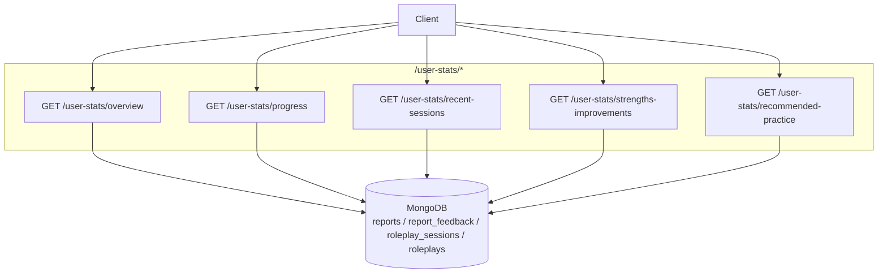

# Communication Coach — User Stats API Documentation

Complete reference for endpoints exposed by `UserStatsController`
([src/modules/user-stats/controllers/user-stats.controller.ts](../src/modules/user-stats/controllers/user-stats.controller.ts)).

---

## Architecture



**Base URL:** `{BASE_URL}` — e.g. `http://localhost:5000`

- Swagger UI: `{BASE_URL}/api/docs`
- OpenAPI JSON: `{BASE_URL}/api/docs-json`
- No global route prefix — paths are exactly `/user-stats/...`.
- All endpoints return `200` on success.

**Standard request headers:**

```typescript
{
  "Authorization": "Bearer <ACCESS_TOKEN>"
}
```

---

## Shared TypeScript Types

```typescript
export interface ScoreImprovement {
  percent?: number;      // present when comparable
  note?: string;         // "Not enough data" when baseline missing/zero
}

export interface ProgressPoint {
  label: string;         // e.g. YYYY-MM-DD or YYYY-W##
  date: string;          // same as label, kept for sorting
  avgScore: number;      // averaged completed-report score
  count: number;         // number of completed reports in bucket
}
```

---

## Endpoint Overview

| ID | Method | Path | Auth | Purpose |
|----|--------|------|------|---------|
| U1 | GET | `/user-stats/overview` | Bearer JWT | Four stat cards + progress series for a user and date range |
| U2 | GET | `/user-stats/progress` | Bearer JWT | Only the progress series (same range defaults as overview) |
| U3 | GET | `/user-stats/recent-sessions` | Bearer JWT | Latest completed sessions with title, date, duration, score |
| U4 | GET | `/user-stats/strengths-improvements` | Bearer JWT | Aggregated strengths and growth points from feedback |
| U5 | GET | `/user-stats/recommended-practice` | Bearer JWT | Recommended roleplays tailored to weaker areas |

---

## U1 — Overview (four cards + progress)

| | |
|---|---|
| **Method / Path** | `GET /user-stats/overview` |
| **Auth** | Bearer JWT |
| **Query** | `?userId=...&start=...&end=...` |
| **Source** | [user-stats.controller.ts](../src/modules/user-stats/controllers/user-stats.controller.ts) |

**Query parameters:**

```typescript
interface OverviewQuery {
  userId: string;     // required — Mongo ObjectId
  start?: string;     // ISO date — defaults to first day of current month
  end?: string;       // ISO date — defaults to last day of current month
}
```

**Success 200:**

```json
{
  "stats": {
    "averageScore": 3.8,
    "completedSessions": 24,
    "totalPracticeSeconds": 16500,
    "scoreImprovement": { "percent": 18.0 }
  },
  "period": {
    "start": "2026-10-01T00:00:00.000Z",
    "end": "2026-10-31T23:59:59.999Z",
    "previousStart": "2026-09-01T00:00:00.000Z",
    "previousEnd": "2026-09-30T23:59:59.999Z",
    "currentReportCount": 12
  },
  "progress": {
    "series": [
      { "label": "2026-10-01", "date": "2026-10-01", "avgScore": 3.5, "count": 2 },
      { "label": "2026-10-08", "date": "2026-10-08", "avgScore": 3.9, "count": 3 },
      { "label": "2026-10-15", "date": "2026-10-15", "avgScore": 4.1, "count": 4 }
    ]
  }
}
```

Notes:
- `scoreImprovement.note` is returned as "Not enough data" when the previous period is empty or has zero average.
- Series are daily if the range is ≤ 31 days; otherwise weekly (`YYYY-W##`).

---

## U2 — Progress (graph-only)

| | |
|---|---|
| **Method / Path** | `GET /user-stats/progress` |
| **Auth** | Bearer JWT |
| **Query** | `?userId=...&start=...&end=...` |
| **Source** | [user-stats.controller.ts](../src/modules/user-stats/controllers/user-stats.controller.ts) |

**Query parameters:** same as U1.

**Success 200:**

```json
{
  "progress": {
    "series": [
      { "label": "2026-10-01", "date": "2026-10-01", "avgScore": 3.5, "count": 2 },
      { "label": "2026-10-02", "date": "2026-10-02", "avgScore": 3.7, "count": 1 }
    ]
  },
  "period": {
    "start": "2026-10-01T00:00:00.000Z",
    "end": "2026-10-31T23:59:59.999Z",
    "previousStart": "2026-09-01T00:00:00.000Z",
    "previousEnd": "2026-09-30T23:59:59.999Z",
    "currentReportCount": 12
  }
}
```

---

## U3 — Recent practice sessions

| | |
|---|---|
| **Method / Path** | `GET /user-stats/recent-sessions` |
| **Auth** | Bearer JWT |
| **Query** | `?userId=...&limit=5` |
| **Source** | [user-stats.controller.ts](../src/modules/user-stats/controllers/user-stats.controller.ts) |

**Query parameters:**

```typescript
interface RecentSessionsQuery {
  userId: string;   // required
  limit?: number;   // 1..10, default 5
}
```

**Success 200:**

```json
[
  {
    "_id": "66d1d5f1d8d3070019e8f8c9",
    "rolePlayId": "66d1d5f1d8d3070019e8f8c1",
    "endedAt": "2026-10-12T12:05:00.000Z",
    "createdAt": "2026-10-12T11:40:00.000Z",
    "durationSeconds": 1500,
    "roleplay": { "title": "Leadership & Communication" },
    "report": { "overallScore": 4.2 }
  },
  {
    "_id": "66d1d5f1d8d3070019e8f8d0",
    "rolePlayId": "66d1d5f1d8d3070019e8f8a9",
    "endedAt": "2026-10-10T17:45:00.000Z",
    "createdAt": "2026-10-10T17:15:00.000Z",
    "durationSeconds": 1800,
    "roleplay": { "title": "Handling Client Objections" },
    "report": { "overallScore": 3.8 }
  }
]
```

---

## U4 — Strengths & improvement areas

| | |
|---|---|
| **Method / Path** | `GET /user-stats/strengths-improvements` |
| **Auth** | Bearer JWT |
| **Query** | `?userId=...&sinceDays=30&limit=5` |
| **Source** | [user-stats.controller.ts](../src/modules/user-stats/controllers/user-stats.controller.ts) |

**Query parameters:**

```typescript
interface StrengthsImprovementsQuery {
  userId: string;   // required
  sinceDays?: number; // default 30 (days back)
  limit?: number;     // default 5 (top-N)
}
```

**Success 200:**

```json
{
  "strengths": [
    { "label": "Clear articulation", "count": 6 },
    { "label": "Empathy", "count": 4 }
  ],
  "growthPoints": [
    { "label": "Conciseness", "count": 7 },
    { "label": "STAR: Action detail", "count": 5 }
  ]
}
```

---

## U5 — Recommended next practice

| | |
|---|---|
| **Method / Path** | `GET /user-stats/recommended-practice` |
| **Auth** | Bearer JWT |
| **Query** | `?userId=...&limit=3` |
| **Source** | [user-stats.controller.ts](../src/modules/user-stats/controllers/user-stats.controller.ts) |

**Query parameters:**

```typescript
interface RecommendedPracticeQuery {
  userId: string;  // required
  limit?: number;  // 1..10, default 3
}
```

**Success 200:**

```json
{
  "weakestArea": "conciseness",
  "items": [
    { "_id": "66d1...01", "title": "Be brief, be bright", "category": "communication", "difficulty": "intermediate" },
    { "_id": "66d1...02", "title": "Elevator Pitch", "category": "interview", "difficulty": "beginner" },
    { "_id": "66d1...03", "title": "Client Update Call", "category": "workplace-communication", "difficulty": "intermediate" }
  ]
}
```

Notes:
- `weakestArea` is computed from recent feedback averages across Active Listening, Conciseness, and STAR.
- When no recent feedback exists, `weakestArea` may be `null` and the list falls back to recent active roleplays.
